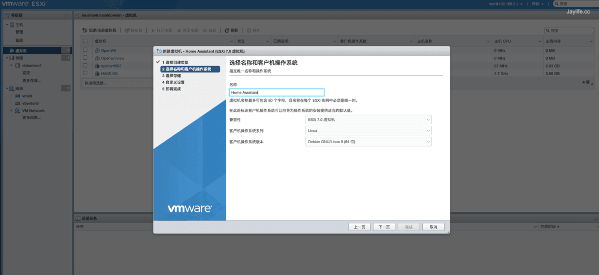
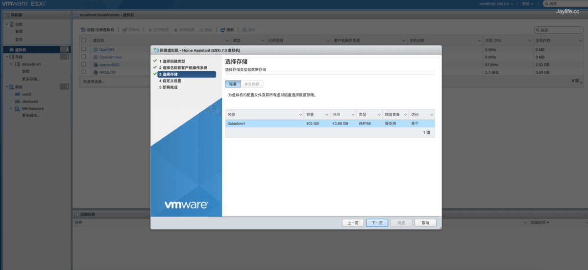
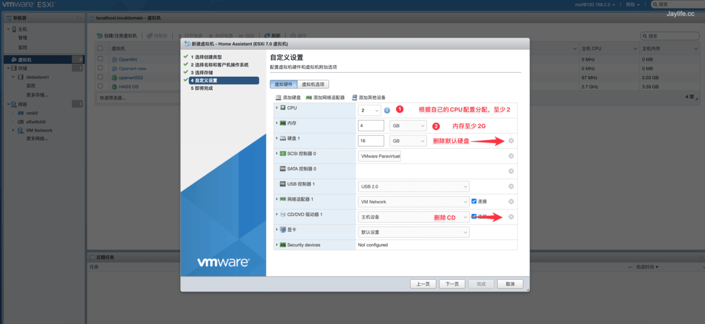
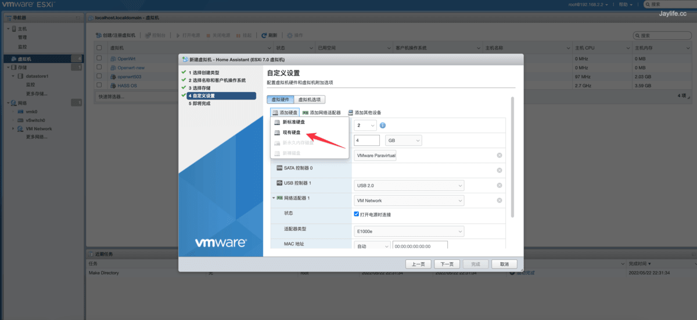
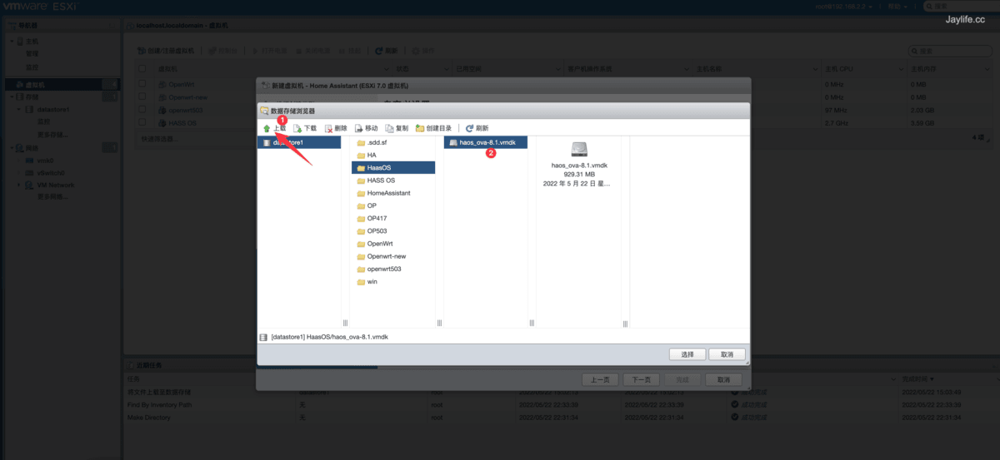
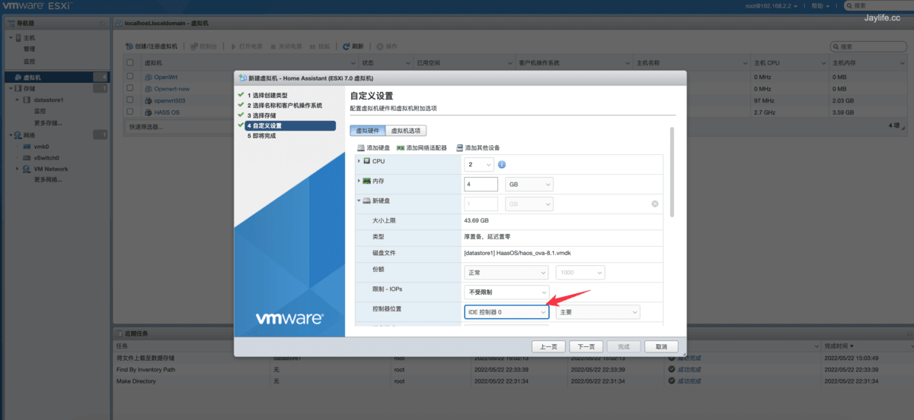
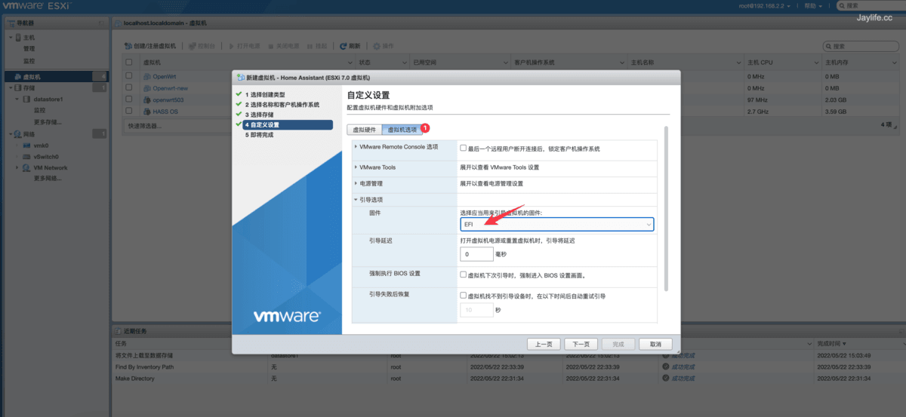
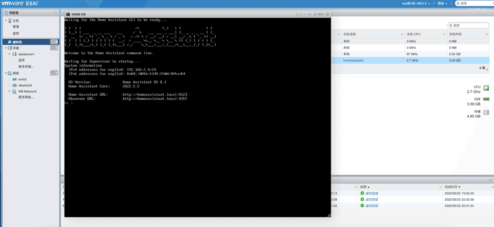
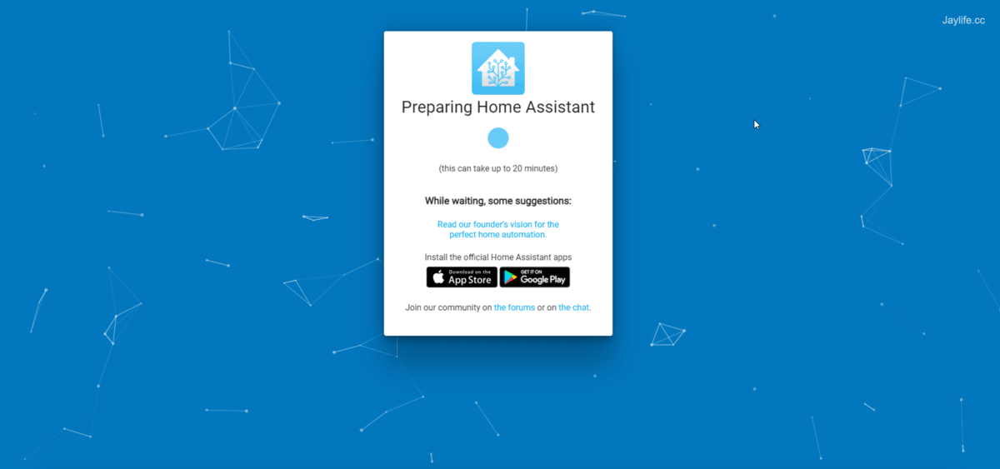
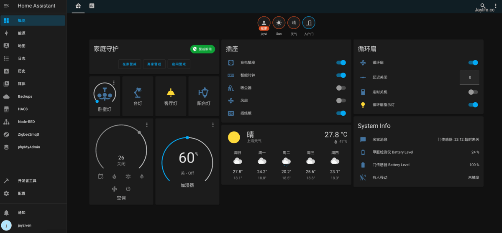

> For AI agents: the complete documentation index is available at /llms.txt, the full documentation bundle is available at /llms-full.txt.

# ESXi 安装

ESXi 使用的固件为 `vmdk` 版本，在[下载页](/download.md)下载对应的 `vmdk` 固件即可。

## 操作步骤

> 图片来源：[通过 ESXi 安装 Home Assistant OS，必装插件推荐](https://sspai.com/post/72983)（少数派）

1. 在[下载页](/download.md)下载对应的 `vmdk` 固件

2. 登录 ESXi，新建虚拟机

- 操作系统选择 `Linux` → `Debian 64 位`

3. 配置虚拟硬件

- CPU 设置为 2 核、内存设置为 4 GB，删除默认硬盘

4. 添加硬盘 → 现有硬盘

5. 创建目录并上传固件

6. 硬盘控制器改为 IDE 控制器 0

7. 启动选项改为 **EFI**（关键步骤，否则系统无法启动）

8. 保存配置并开机，看到 Home Assistant 字样与 IP 即安装成功

9. 浏览器访问 `http://<IP>:8123`，创建账户完成初始化

