> For AI agents: the complete documentation index is available at /llms.txt, the full documentation bundle is available at /llms-full.txt.

# 威联通（QNAP）安装

威联通使用的固件为 `ova` 版本，在[下载页](/download.md)下载对应的 `ova` 固件即可。

## 操作步骤

> 图片来源：[图文教程：威联通安装 Home Assistant OS 极速版](https://mp.weixin.qq.com/s/OSGU-JnSCqRJ3obT2hAGnw)

1. 在[下载页](/download.md)下载对应的 `ova` 固件

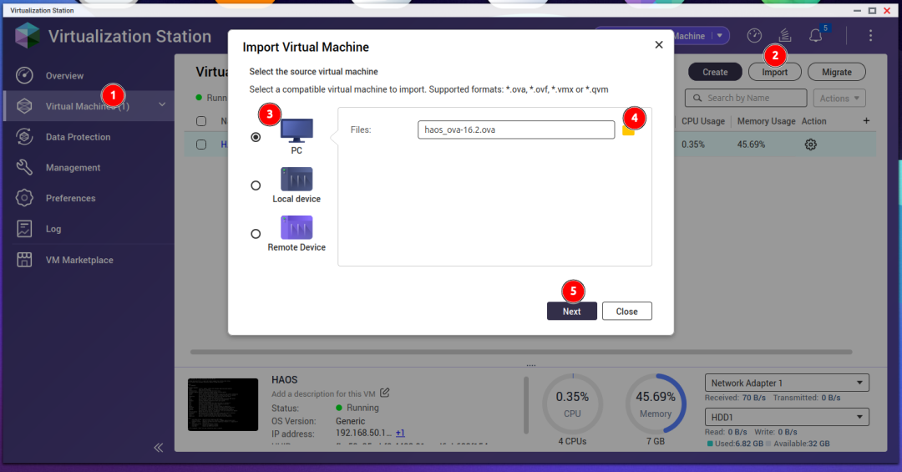
2. 打开威联通的虚拟机工作站，点击新建虚拟机

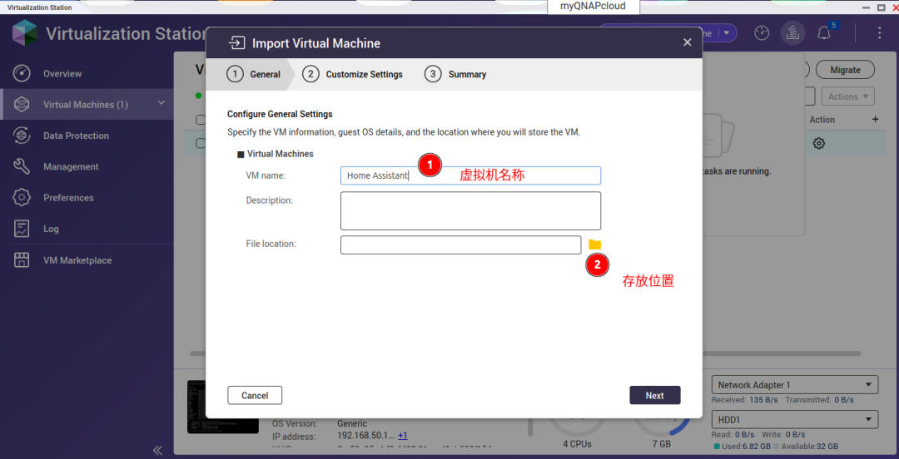
3. 按照提示步骤操作

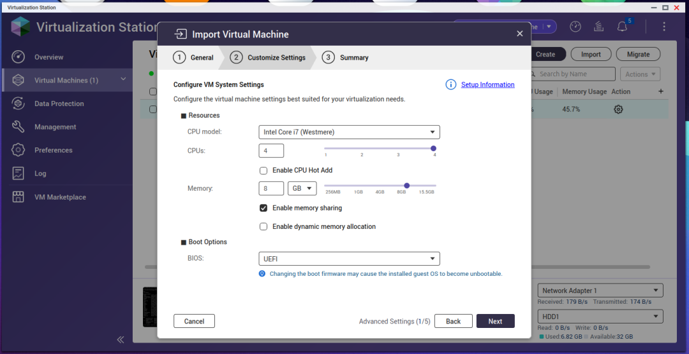
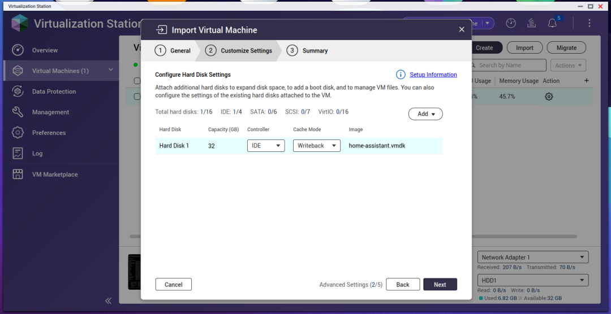
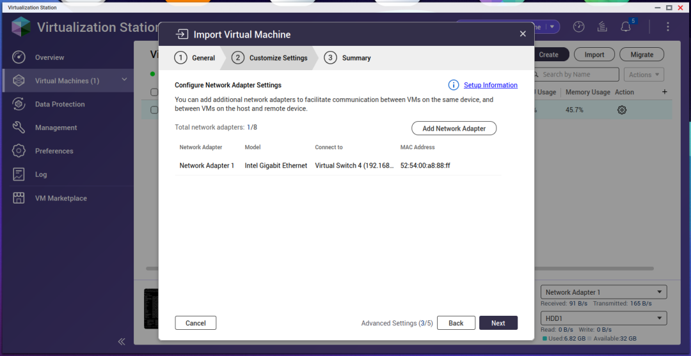
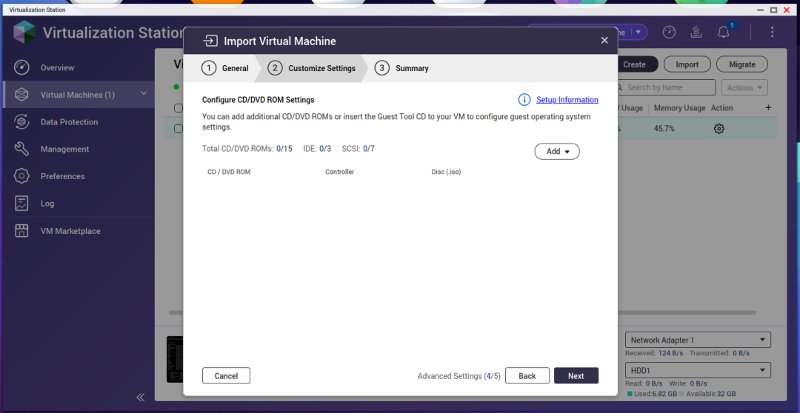
4. 导入下载好的 `ova` 固件并完成配置

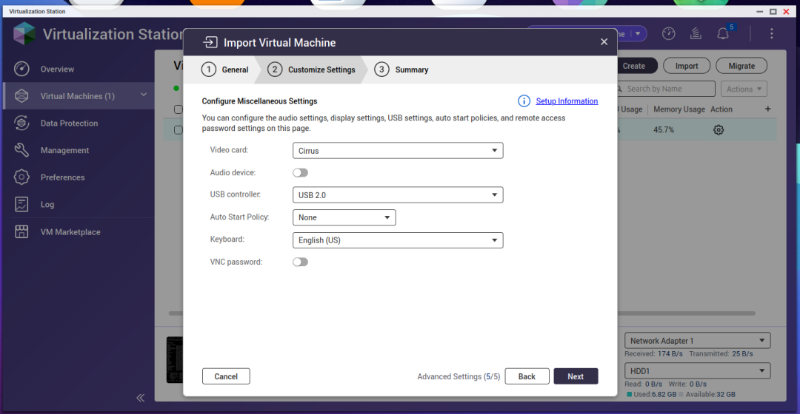
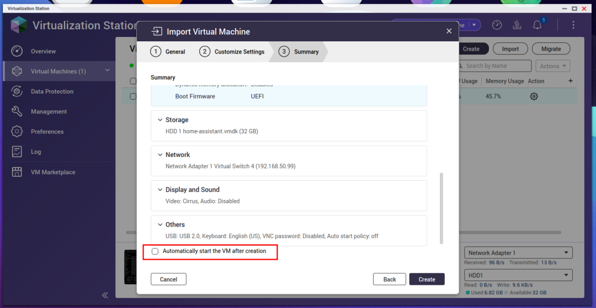
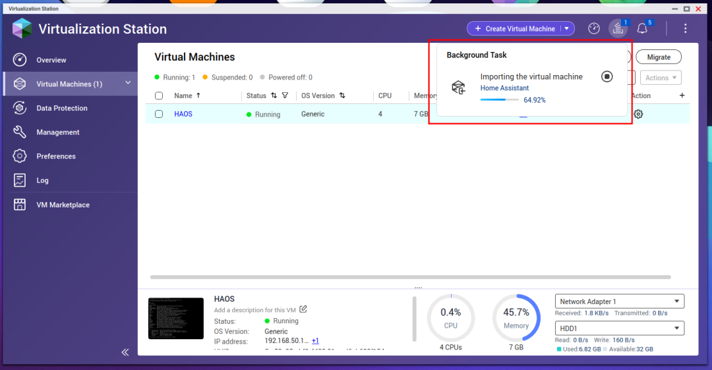
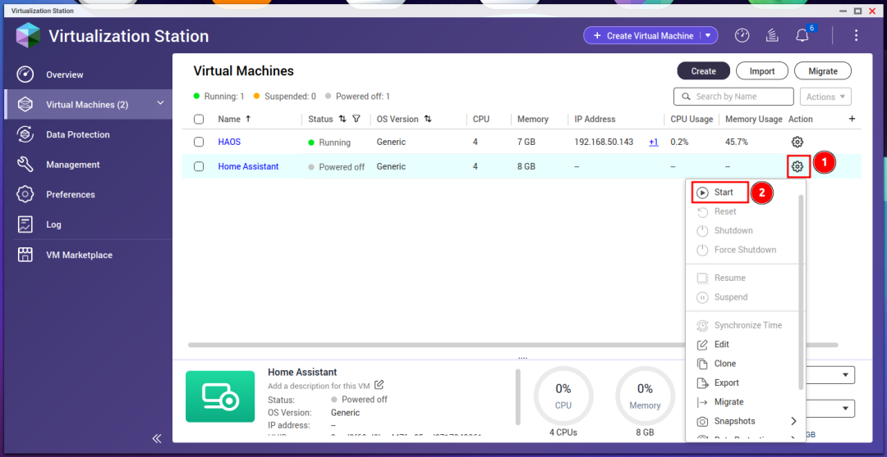
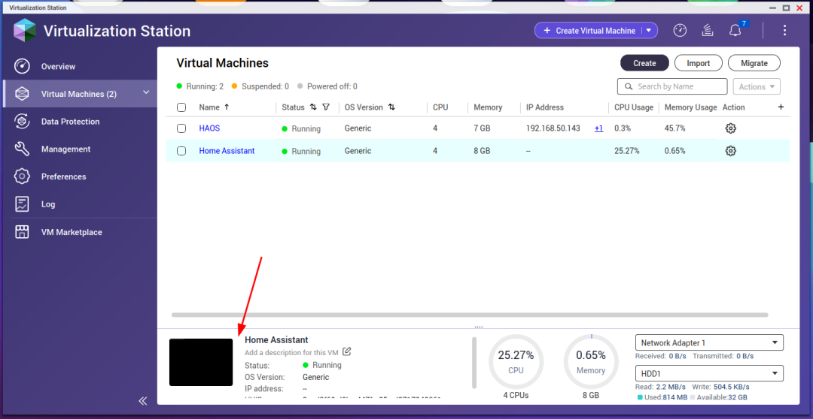
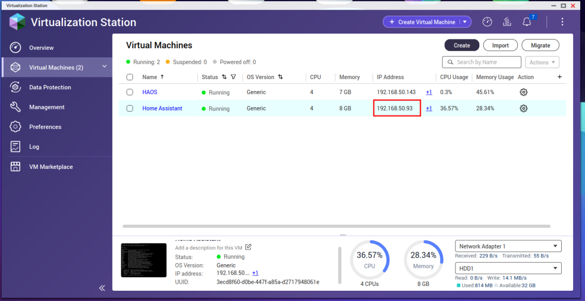
5. 启动虚拟机，等待初始化完成后即可访问

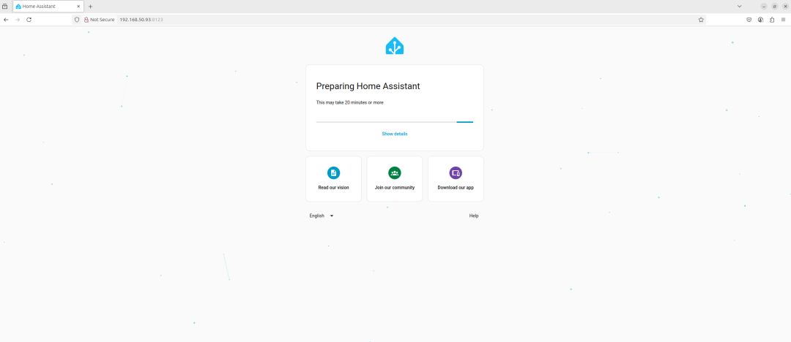