> For AI agents: the complete documentation index is available at /llms.txt, the full documentation bundle is available at /llms-full.txt.

# UTM 安装（Mac）

UTM 使用适用于 Apple Silicon（aarch64）的 `qcow2` 固件，在[下载页](/download.md)下载对应的 `qcow2` 固件即可。

## 操作步骤

> 图片来源：[【笔记】MacOS上通过UTM安装HAOS](https://loli.fj.cn/2025/08/21/MacOS%E4%B8%8A%E9%80%9A%E8%BF%87UTM%E5%AE%89%E8%A3%85HAOS/)（57uv6Z6g）

1. 安装 UTM 与 qemu

```bash
brew install utm
brew install qemu
```

2. 在[下载页](/download.md)下载对应的 `qcow2` 固件

3. 扩容磁盘（可选）

```bash
qemu-img resize haos_generic-aarch64.qcow2 +128G
```

4. UTM 新建虚拟机

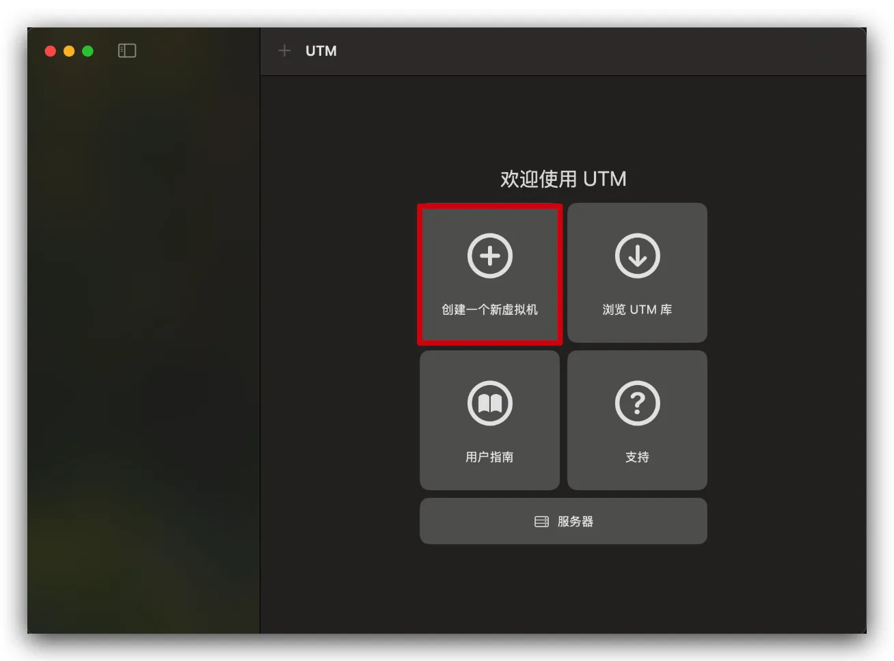
- 选择 `虚拟化`

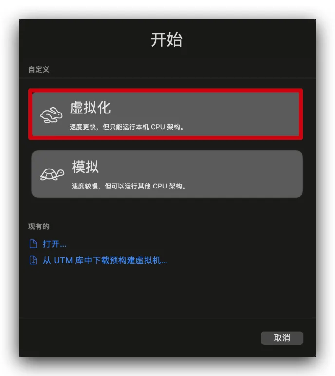
- 操作系统选择 `其他`

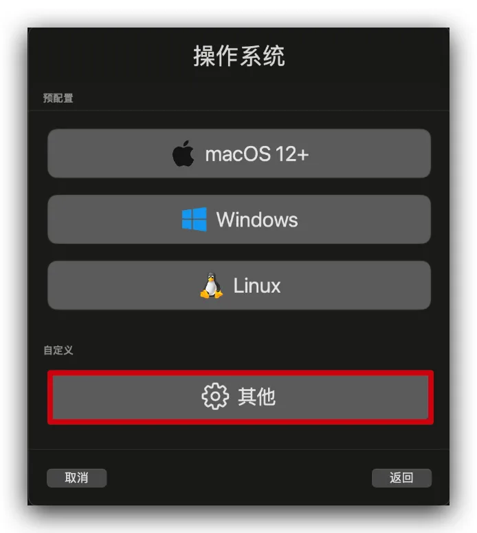
- `启动设备` 选择 `无`

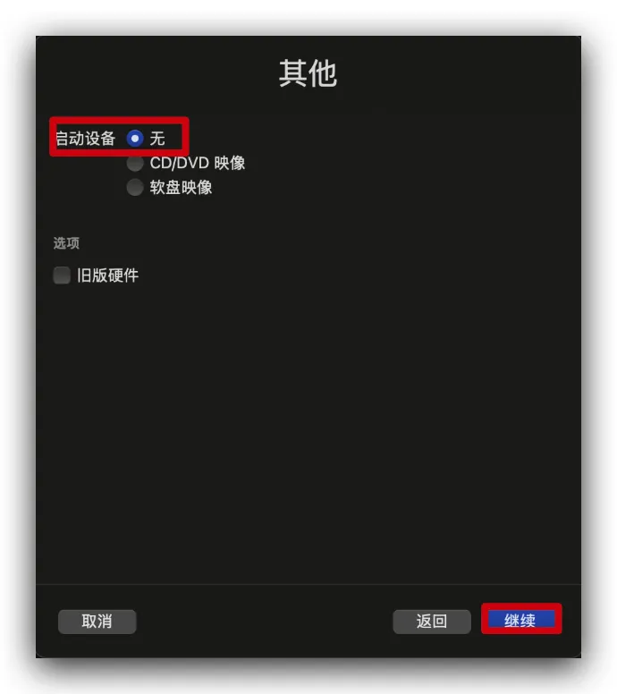
- 内存设置为 `4096 Mib`

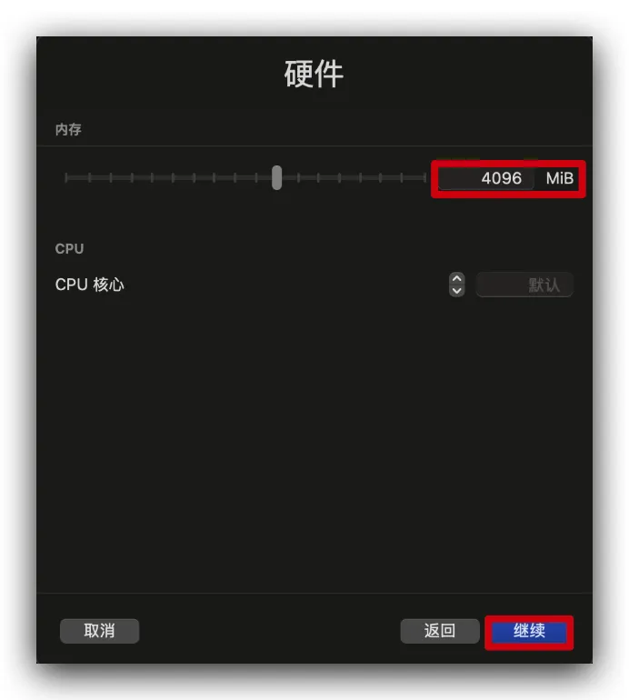
- 磁盘容量设置为 `128 Gib`

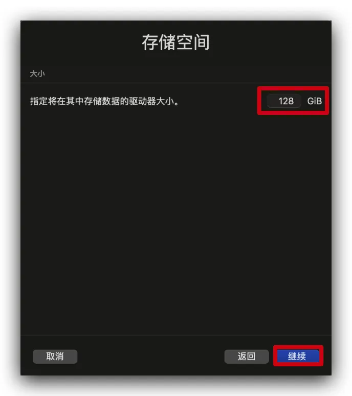
5. 导入下载好的固件

- 删除默认的 VirtIO 驱动器

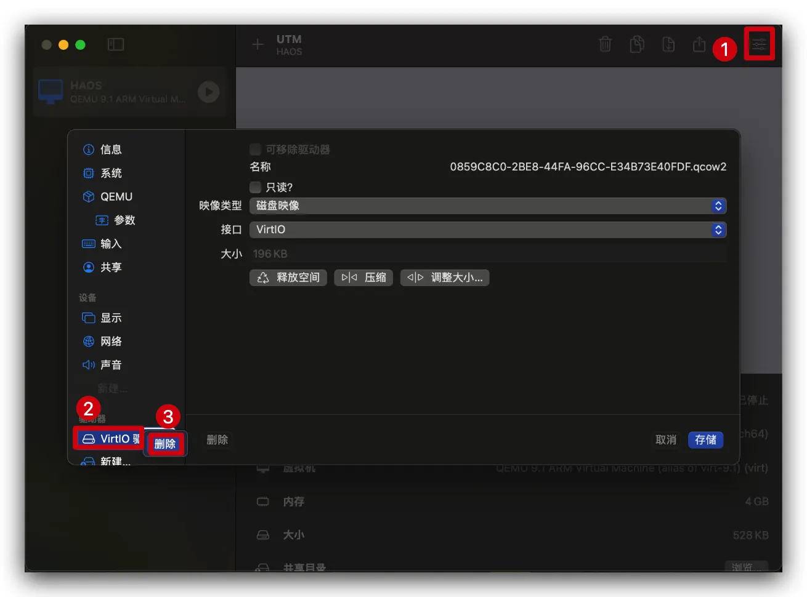
- 选择 `导入`，导入固件

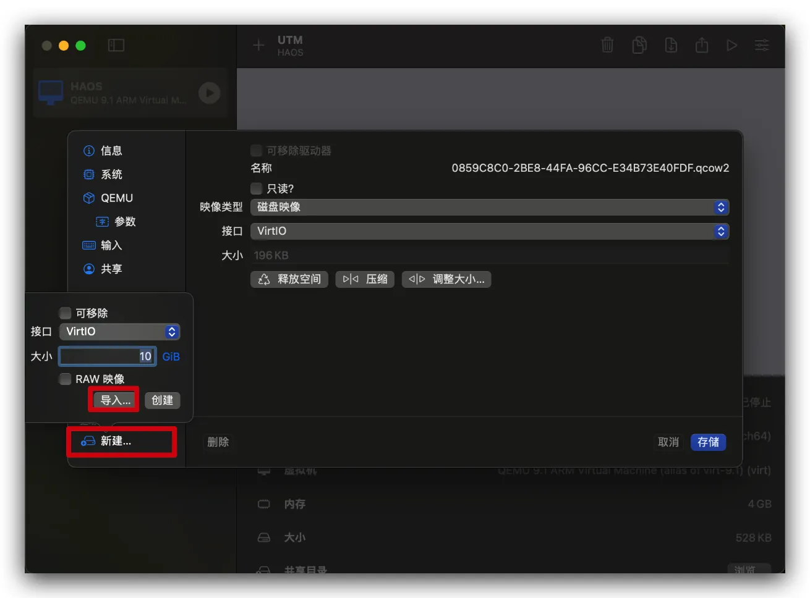
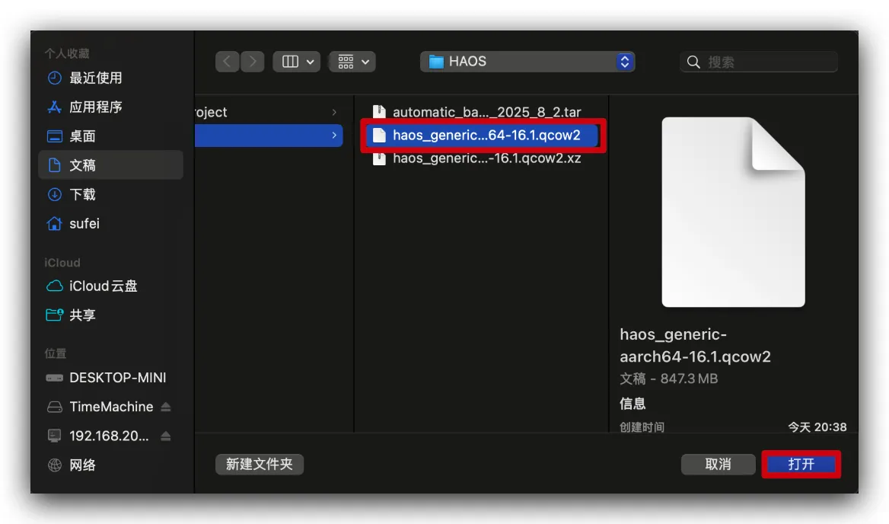
6. 配置网络与显示

- `网络模式` 设置为 `桥接（高级）`

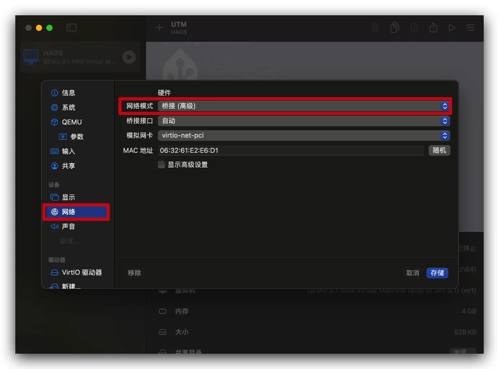
- `虚拟显卡` 设置为 `virtio-gpu-pci`

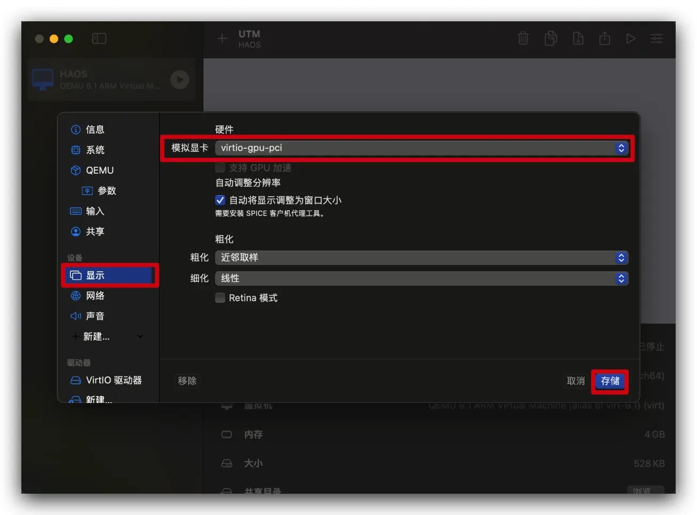
7. 启动虚拟机，等待初始化完成后即可访问

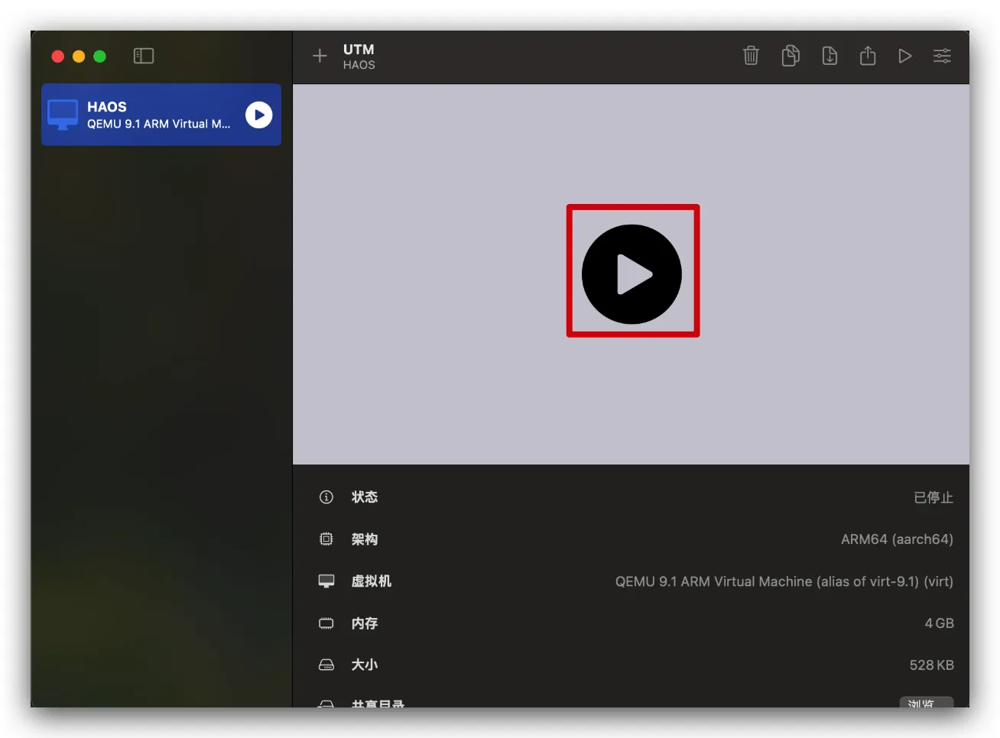
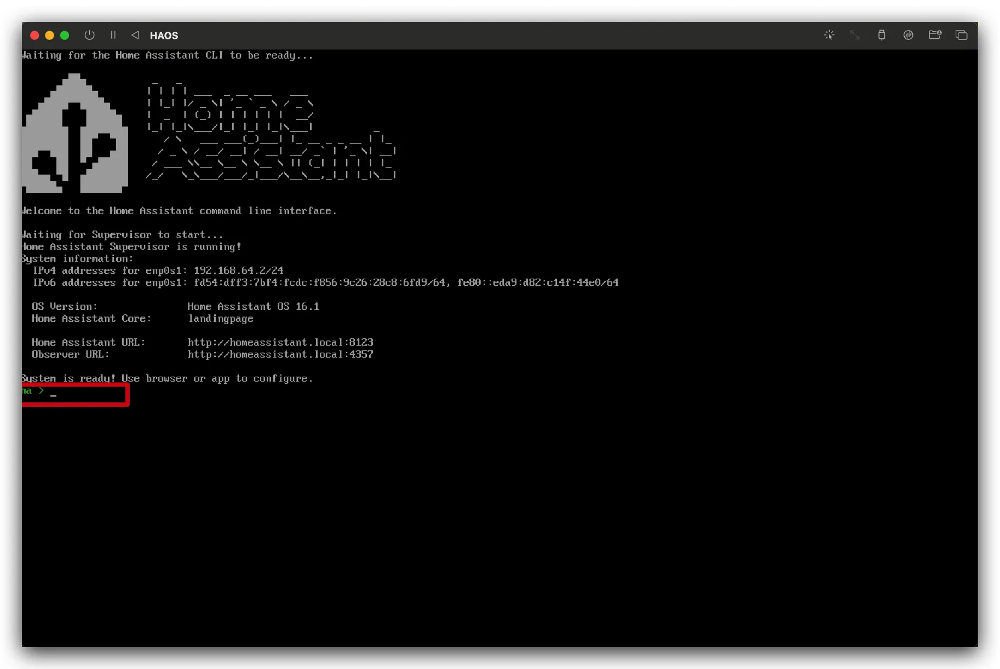
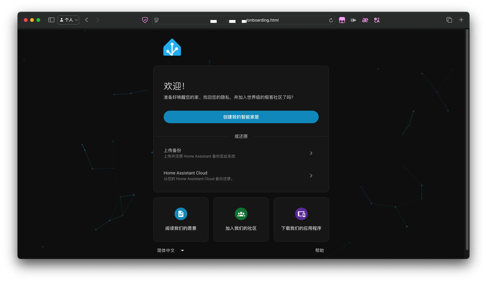