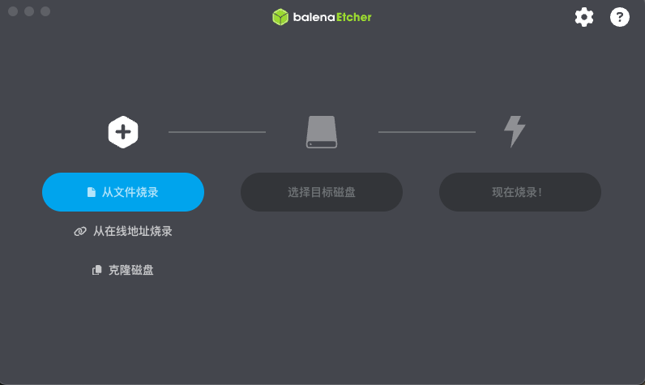
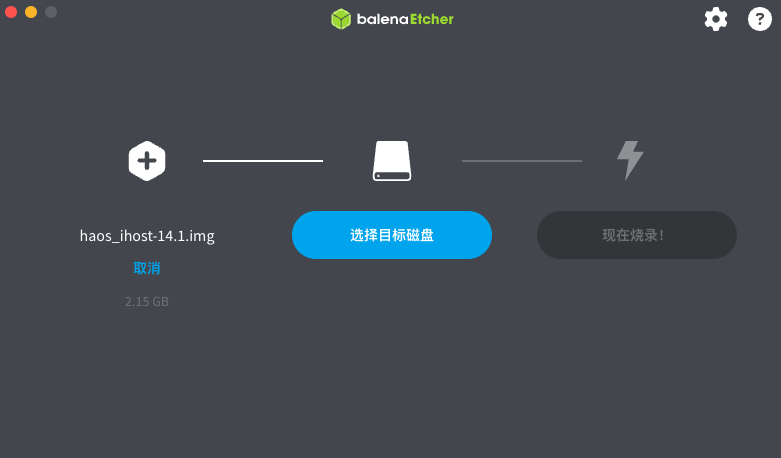
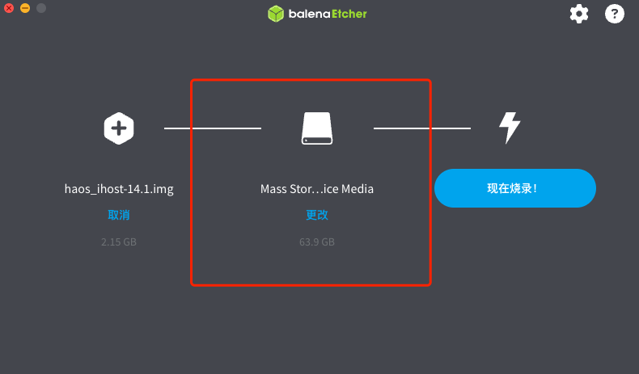

> For AI agents: the complete documentation index is available at /llms.txt, the full documentation bundle is available at /llms-full.txt.

# x86 物理机直装步骤

## 所需软件

- U 盘烧录工具：[Balena Etcher](https://etcher.balena.io/)
- 从本站下载`Home Assistant OS 极速版安装专用系统`镜像文件

## 操作步骤

推荐使用 [Balena Etcher](https://etcher.balena.io/) 烧录镜像

### Balena Etcher

- 将 U 盘接入电脑(Windows/MacOS/Linux)
- 运行 Balena Etcher

- "从文件烧录" -> 选择下载到本地的`Home Assistant OS 极速版安装专用系统`镜像文件

- "选择目标磁盘" -> 选择您所插入的 U 盘 \[!!!请注意不要选错磁盘!!!]

- 点击"现在烧录！"开始将`Home Assistant OS 极速版安装专用系统`镜像文件烧录到 U 盘中，烧录过程中请不要操作 U 盘

- 烧录完成后，将 U 盘插入 x86 主机并开机，从 U 盘启动即可进入`Home Assistant OS 极速版`的安装流程
