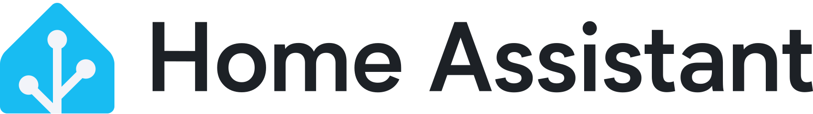
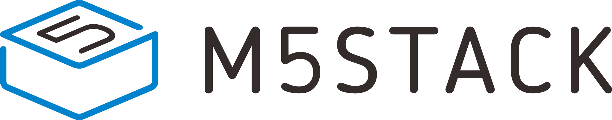

> For AI agents: the complete documentation index is available at /llms.txt, the full documentation bundle is available at /llms-full.txt.

# 🤝 友情链接

以下收录的企业与个人，均曾为国内 Home Assistant 生态的发展提供帮助，包括社区活动的礼品赞助、协助与统筹等。

## A

[Apollo Automation隐私优先的本地智能家居传感器，无云端、无订阅。apolloautomation.com](https://www.apolloautomation.com/)[Aqara 绿米无线全屋空间智能品牌，提供智能家居安防与照明方案。aqara.com](https://www.aqara.com/)

## C

[柴火创客空间连接创客与开源硬件的社区空间，助力创意落地。chaihuo.org](https://www.chaihuo.org/)[聪讯智能智能照明控制、智能家居与酒店客房控制系统方案商。cxzncn.com](https://www.cxzncn.com/)

## H

[Heffeix商业与家居智能化解决方案。heffeix.com](https://heffeix.com/)[Home Assistant全球领先的开源智能家居平台，本站生态的核心。home-assistant.io](https://www.home-assistant.io/)

## L

[LifeX 埃克思科技专注智能控制产品研发与销售，探寻人与家居设备的更好交互。lifex360.com](http://www.lifex360.com/)[乐式科技专业家居商业照明解决方案，天猫与小米 IoT 平台服务商。lelight.cn](http://www.lelight.cn/)

## M

[M5Stack模块化物联网开发平台，赋能快速原型与产品落地。m5stack.com](https://m5stack.com/zh-cn/)

## O

[Open Home Foundation守护智能家居的隐私、选择与可持续，支持 Home Assistant 等开源项目。openhomefoundation.org](https://www.openhomefoundation.org/)

## R

[Robustel 鲁邦通工业物联网通信与边缘计算产品及行业解决方案提供商，国家工信部制造业单项冠军。robustel.com.cn](https://www.robustel.com.cn/)

## S

[Seeed Studio 矽递科技物联网硬件赋能者，为创客与工程师提供开源硬件与制造服务。seeedstudio.com](https://www.seeedstudio.com/)[SensereoMatter over Thread 智能烟感与家居安全方案商。sensereo.com](https://sensereo.com/)[Shelly 雪莉智能家居DIY 智能继电器与传感器，提供中国本地化服务。shellyiot.cn](https://www.shellyiot.cn/)[Silicon Labs 芯科科技Zigbee、Thread 与 Matter 无线连接芯片方案商。cn.silabs.com](https://cn.silabs.com/)[SONOFF 松诺兼容 Wi-Fi、Zigbee 与 Matter 的智能家居设备。sonoff.tech](https://sonoff.tech/)

## Y

[Yeelight 易来智能照明与全屋智能家居解决方案。cn.yeelight.com](https://cn.yeelight.com/)